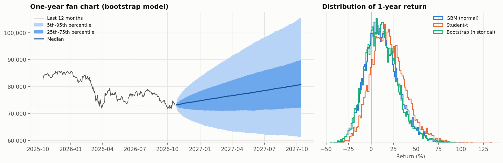

# Monte Carlo Simulation for Stock Market Risk (Sensex)

My course project for **Monte Carlo Methods in Finance**, extended. It answers a simple question: *if you hold a position in the Sensex, how much could you lose on a bad day, and can you trust that estimate?*

**Stack:** Python (pandas, NumPy, SciPy, scikit-learn, matplotlib) · SQL (SQLite)

> **Run it:** open `Sensex_Monte_Carlo_VaR.ipynb` in Google Colab and choose *Runtime → Run all* (about 1 minute). Market data downloads automatically, so the numbers below are from a run on 23-Oct-2026.

## v1: the course project (Feb 2026)
Simulated 1,000 random one-year price paths of the Sensex and estimated a 95% **Value-at-Risk**: the one-day loss you're 95% confident won't be exceeded. The notebook and report are in [`reference/`](reference/).

## v2: what I improved

1. **Checked the v1 model.** The numbers recomputed correctly from fresh data, but annual volatility had been calculated with the wrong formula (14.9% instead of 18.4%), which made the stress-test figures about 20% too high. Fixed.
2. **Better simulation.** 10,000 paths using three models: a normal model, a fat-tailed model, and one that resamples real historical returns. A convergence test shows the estimate settles to about 1% error at 10,000 paths.
3. **Checked predictions against reality.** For every day since 2017, I compared the model's predicted worst-case loss with what actually happened.
   - The **normal model** was beaten about twice as often as it should have been (46 times vs ~24 expected), mostly during the March 2020 COVID crash.
   - A model that **adjusts to current volatility** stayed close to the expected rate, so I recommend it.
4. **Extras**
   - data-quality checks on the price data
   - detection of unusual trading days
   - stress scenarios (worst historical days, sudden falls)
   - a small multi-asset ETF portfolio, where stocks were about half the money but most of the risk
   - SQL queries
   - CSV exports ready for a dashboard

<p align="center">
  <br>
  
</p>

## Key numbers (₹1 crore Sensex position)

| | |
|---|---|
| Sensex annual volatility (2016–2026) | 16.3% |
| One-day 99% VaR: normal model | ₹2.34 lakh |
| One-day 99% VaR: historical returns | ₹2.62 lakh |
| Worst actual day | −13.15% (23-Mar-2020) |
| Biggest fall from peak | −38.1% (recovered in 231 days) |

## Files

```
Sensex_Monte_Carlo_VaR.ipynb             main notebook (v2, with outputs)
reference/v1_course_project.ipynb        v1 course-project notebook
reference/Monte_Carlo_course_report.pdf  v1 report (17-Feb-2026)
outputs/charts/                          charts
outputs/powerbi/                         CSV tables for a dashboard
```

**Limitations:** the analysis covers a single index position, and scaling one-day risk to ten days assumes each day is independent, which understates risk in a crisis.
