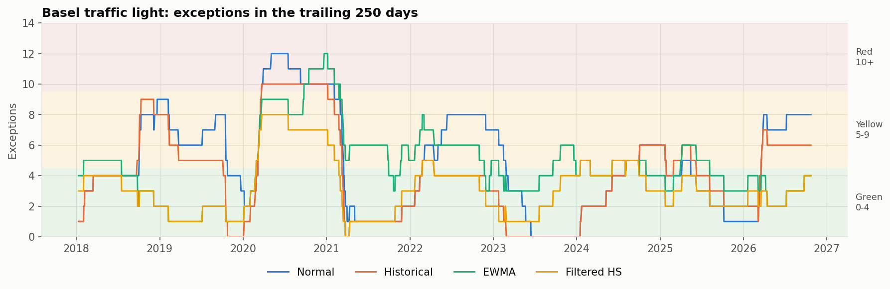
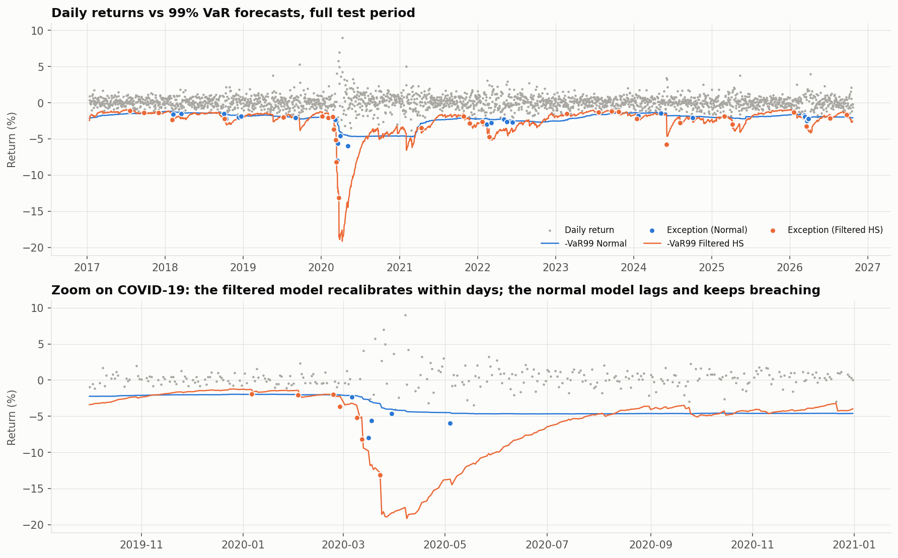
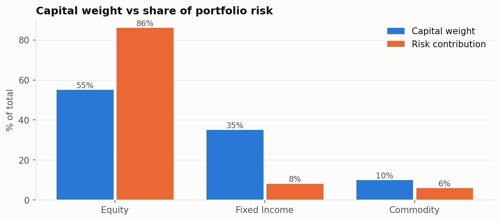
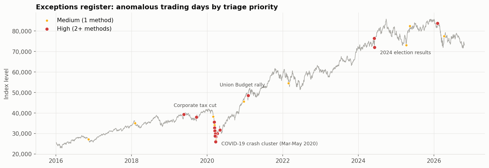

# Market Risk Analytics & VaR Model Assurance

An end-to-end market-risk project on the **Sensex** and an **iShares multi-asset model portfolio**. It started as my course project for **Monte Carlo Methods in Finance**: VaR via Monte Carlo simulation on the BSE Sensex (the v1 notebook and report are in [`reference/`](reference/)). This second version treats my v1 model as a *model under review*: it tests the input data, re-performs the original calculations, documents the errors it finds, rebuilds the analytics properly, and **backtests every VaR model against realised returns**. The outputs are SQL queries, Power BI-ready tables, and an LLM-drafted audit memo whose figures are checked automatically before a person signs it off.

**Stack:** Python (pandas, NumPy, SciPy, scikit-learn, matplotlib) · SQL (SQLite) · Power BI (CSV star schema + DAX) · Claude API (optional, with guardrails)

> **Open in Colab:** upload `Market_Risk_VaR_Assurance.ipynb` and choose *Runtime → Run all* (about 1 minute). Market data is downloaded live with `yfinance`, so the figures below are a snapshot from the run on 23-Oct-2026.

---

## Headline results

| Area | Result |
|---|---|
| Data quality | 11 automated controls on 2,661 records: 0 FAIL, 4 REVIEW (holiday gaps, a −13% day, zero and spiking volume). Volume excluded from modelling. |
| Re-performance | Original daily vol and VaR reproduced from an independent source to within **0.23%** |
| Original model | **10 findings (3 High).** Volatility annualised with `(1+σ)^12−1`, giving **14.9% instead of 18.4%**; stressed VaR overstated by **~20%**; no backtesting; circular "VaR simulation" |
| Fat tails | Excess kurtosis **18.9**; 3-sigma days occur **1.28%** of the time against 0.27% under a normal distribution (4.7×) |
| VaR / ES (₹1 crore, 1-day 99%) | Normal ₹233,833 · Historical ₹261,562 · **Expected Shortfall ₹435,756** (1.7× VaR) |
| **Backtest** (2,409 out-of-sample days) | Normal model: **46 exceptions vs 24 expected**, Kupiec p < 0.001, Red zone on 10% of days, **rejected**. **Filtered Historical Simulation**: 31 exceptions, passes Kupiec (p = 0.18) and Christoffersen (p = 0.37), never in the Red zone, **recommended** |
| Anomaly detection | 29 days flagged by 3 methods (threshold, volatility-adjusted z-score, Isolation Forest); 15 High priority. The regime-aware rule finds 5 days the ±5% rule misses and drops 7 false alarms |
| Stress | Worst day −13.15% (5× VaR); max drawdown −38.1%, recovered in 231 days; reverse stress: a 24.8% ten-day fall uses up a 3× VaR capital buffer |
| Model portfolio | Equities are **55% of capital but 86% of risk**. The 2022 rate shock (−$206k) was worse than COVID (−$184k) and **4× the 10-day VaR**, because bonds fell with stocks |
| AI memo | 30 of 30 figures traced to model output; a deliberately tampered figure is caught by the guardrail |

<p align="center">
  <br>
  <br>
   
</p>

## What the notebook covers

| § | Section | Techniques |
|---|---|---|
| 1 | Data ingestion | Source fallback chain (local CSV → yfinance → labelled synthetic), source recorded for traceability |
| 2 | Data quality controls | 11 controls (completeness, uniqueness, OHLC integrity, staleness, gaps, calendar, plausibility, volume), exception log, row reconciliation |
| 3 | Independent review | Re-performance, logic review, circularity test, rated findings register |
| 4 | EDA & tail risk | Drawdowns, volatility regimes (21-day and EWMA), Jarque-Bera, Q-Q plot, Student-t fit |
| 5 | Anomaly detection | Fixed threshold, look-ahead-free volatility-adjusted z-score, Isolation Forest, triaged register |
| 6 | Monte Carlo | Vectorised GBM / Student-t / bootstrap (10,000 × 252), fan chart, convergence test |
| 7 | VaR & ES | Parametric, historical, Cornish-Fisher, Student-t, EWMA, filtered HS; 95/99%, 1- and 10-day |
| 8 | Stress testing | Volatility regimes, historical replay, hypothetical shocks, reverse stress test |
| 9 | Backtesting | Rolling 250-day forecasts, Kupiec POF, Christoffersen independence, conditional coverage, Basel traffic light |
| 10 | Model portfolio | iShares ETFs, Euler risk contributions, diversification benefit, regime correlations, scenario P&L, drift and rebalance flags |
| 11 | SQL | Yearly risk profile, pivot by conditional aggregation, CTE self-join for exception clustering, anomaly vs DQ cross-check |
| 12 | Power BI | 12 fact/dimension tables, data dictionary, suggested report pages, DAX measures |
| 13 | AI memo | Grounded prompt, number extraction and tracing, tamper test, human sign-off; deterministic fallback |
| 14 | Summary | Results table, recommendations, limitations and next steps |

## Repository layout

```
Market_Risk_VaR_Assurance.ipynb   main notebook (executed, outputs included)
outputs/charts/                   15 PNG charts
outputs/powerbi/                  12 CSV tables + data_dictionary.csv
outputs/audit_memo.md             AI/template-drafted memo (marked DRAFT)
reference/v1_course_project.ipynb        v1: course-project notebook (the model reviewed in §3)
reference/Monte_Carlo_course_report.pdf  v1: course-project report (17-Feb-2026)
requirements.txt
```

## Running it

* **Colab:** *Runtime → Run all*. Optional: upload the original `Sensex.csv` to reproduce the 2016–2021 sample exactly.
* **Locally:** `pip install -r requirements.txt`, then `jupyter notebook Market_Risk_VaR_Assurance.ipynb`.
* **Optional Claude step:** add `ANTHROPIC_API_KEY` as a Colab secret or environment variable. Without it, a deterministic template memo goes through the same checks.
* **Offline:** the notebook falls back to clearly labelled synthetic data so every cell still runs. Don't draw conclusions from it.

## Limitations

√10 scaling assumes independent returns; the VaR is for one linear position; the portfolio uses USD returns with no FX overlay; event annotations are analyst notes to be corroborated. Next steps are listed in §14 of the notebook.

*The model portfolio is illustrative. It is not a BlackRock model portfolio or investment advice.*
